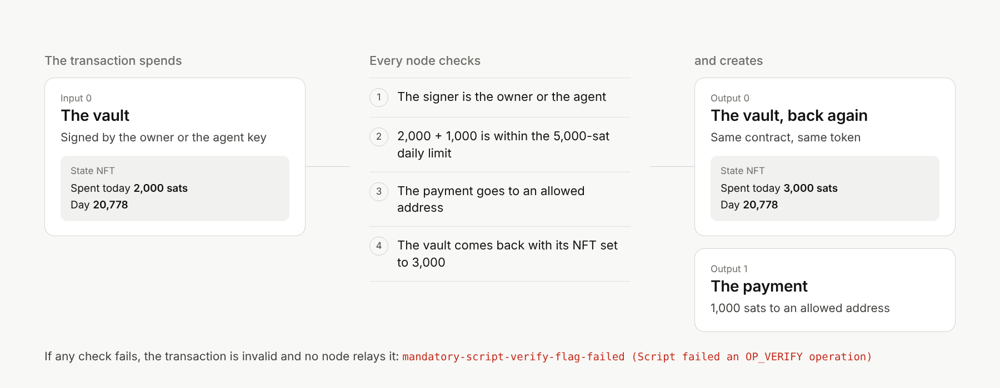
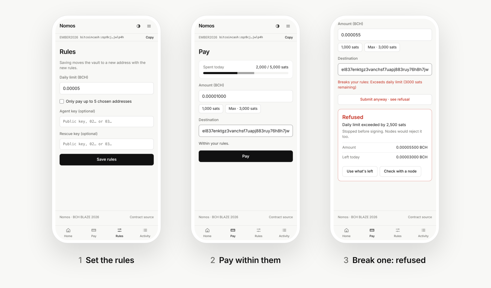

<a href="https://nomos.asgaya.org">
  <picture>
    <source media="(prefers-color-scheme: dark)" srcset=".github/assets/banner-dark.png" />
    <source media="(prefers-color-scheme: light)" srcset=".github/assets/banner-light.png" />
    
  </picture>
</a>

# Nomos

Nomos keeps your BCH in a CashScript vault, and your rules (a daily limit, an allowlist, an agent key and a rescue key) are part of the contract. A payment that breaks a rule fails the script, so no node relays it and no miner can include it, whichever app built it and whoever signed it.

- **Use it:** [nomos.asgaya.org](https://nomos.asgaya.org), with Paytaca over WizardConnect. No account, no Nomos fee.
- **Watch it:** [the demo video](https://youtu.be/eR8DS4LNMvA).
- **Read the rule:** [`contracts/NomosVault.cash` line 45](contracts/NomosVault.cash#L45), `require(effectiveSpent + amount <= dailyLimitSats);`
- **Check the chain:** [every mainnet transaction](docs/MAINNET_PROOFS.md), by component.
- **Built for BCH BLAZE 2026:** Mainnet Track, SolidCash, Decentralized Identity, Stablecoin Bridge and XO ([map](#bch-blaze-2026)).

## Check it in three minutes

1. **Read the rule.** The daily limit is one line of the contract: [`NomosVault.cash#L45`](contracts/NomosVault.cash#L45). The allowlist is [lines 47 to 61](contracts/NomosVault.cash#L47-L61).
2. **Open the transactions.** The SolidCash edition of the vault on mainnet: [deployed](https://blockchair.com/bitcoin-cash/transaction/bee48c5f73f16a9ad83669b4a1350d01e07ebf104d155e2b557837e9fd04113d), [paid under its limit](https://blockchair.com/bitcoin-cash/transaction/93e9fdadaf3ebc5b5182a5b3dcd527b8ab9c6d8480160276a573b9d7b616aae6), refused over it, then [rescued with two keys](https://blockchair.com/bitcoin-cash/transaction/305c7a47a2721ba1b290782df991b5a99bc1da7553b734d764f53e5f81ff913f).
3. **Break a rule yourself.** On [nomos.asgaya.org](https://nomos.asgaya.org), create a vault, pay under the limit, then try more than the limit. The app refuses before your wallet signs, and **Check with a node** sends the signed payment to a node so you can read its rejection. No wallet? The [simulator](https://nomos.asgaya.org/simulate) runs the same rules in the browser.

## The rules

| Rule | What it does | Who it binds | In the contract |
| --- | --- | --- | --- |
| **Daily limit** | Caps what leaves the vault per day. Today's total travels with the vault in a CashTokens NFT, and the day comes from the transaction's locktime. | Every payment, by the owner or the agent | [L37–L45](contracts/NomosVault.cash#L37-L45) |
| **Allowlist** | Up to five P2PKH addresses. A payment anywhere else fails. Entries can be typed as Nostr names. | Every payment, when switched on | [L47–L61](contracts/NomosVault.cash#L47-L61) |
| **Agent key** | A second key, for a person or an AI agent, that can pay within the rules and nothing more. | The agent | [L24](contracts/NomosVault.cash#L24) |
| **Rescue key** | Together with the owner, moves the whole vault in one transaction. | Owner and rescuer together | [L91–L94](contracts/NomosVault.cash#L91-L94) |
| **Rule changes** | Move the vault to a new address with new rules. | The owner | [L85–L87](contracts/NomosVault.cash#L85-L87) |

The rules are constructor parameters, so they are part of the vault's address: a vault with different rules is a different address.

## What a payment looks like on chain

<picture>
  <source media="(prefers-color-scheme: dark)" srcset=".github/assets/figures/anatomy-dark.png" />
  
</picture>

The same payment in the app, from setting the rules to a refusal:

<picture>
  <source media="(prefers-color-scheme: dark)" srcset=".github/assets/captures/flow-dark.png" />
  
</picture>

## What it protects

| Situation | What happens with Nomos |
| --- | --- |
| An agent key leaks, or an AI agent misbehaves | It can spend at most what is left today, and only to allowed addresses. The owner can replace the key or rescue the vault. |
| A buggy or compromised website builds a payment that breaks the rules | Nodes reject it. The app is not what enforces the rules. |
| You type an amount over the limit | Refused before your wallet signs, and invalid if signed anyway. |
| The owner key | The owner can change the rules, so the owner key stays in your own wallet. Paytaca holds it, and Nomos never sees it. |

## One vault, three editions

| Edition | Written in | Status | Look here |
| --- | --- | --- | --- |
| **The app's vault** | CashScript 0.11 | Live on mainnet in the app | [`contracts/NomosVault.cash`](contracts/NomosVault.cash) |
| **SolidCash edition** | SolidCash 0.51 | Deployed, paid, refused and rescued on mainnet; 14 checks in the BCH VM | [`contracts/solidcash/`](contracts/solidcash) |
| **XO template** | XO | Pay, top up, withdraw and a two-party rescue; 14 checks show every script matches CashScript byte for byte; the vault was created on chipnet through XO's engine | [`xo/`](xo) |

## Also in the app

| Feature | What it does | Where |
| --- | --- | --- |
| **Pay by Nostr name** | Type an `npub`, `nprofile` or `name@domain`. The address comes from the key's signed event, checked in your browser; the rules still apply. | [`/pay`](https://nomos.asgaya.org/pay) |
| **BCH and Nostr identity** | Link an address to a Nostr key with both keys signing. Anyone can verify it, and other apps can use it for login. | [`/identity`](https://nomos.asgaya.org/identity), [protocol](docs/IDENTITY_PROTOCOL.md) |
| **Proof checker** | Sends a signed payment that breaks your rules to a node and keeps its answer. | [`/proof`](https://nomos.asgaya.org/proof) |
| **Swap PUSD and USDC** | PUSD on Bitcoin Cash for USDC on Base, between two people, with hash-time locks on both chains. | [`/bridge`](https://nomos.asgaya.org/bridge) |
| **Activity** | Every payment, refusal and rule change, each with a receipt to save, copy or share. | [`/activity`](https://nomos.asgaya.org/activity) |
| **Simulator** | The rules with example numbers, no wallet needed. | [`/simulate`](https://nomos.asgaya.org/simulate) |

Light and dark themes, bottom tabs on phones, and keyboard shortcuts on desktop (press `?`).

## BCH BLAZE 2026


| Track or bounty | Where to look |
| --- | --- |
| **Mainnet Track** | The [live app](https://nomos.asgaya.org); WizardConnect in [`wallet.ts`](frontend/src/lib/wallet.ts); the banner with the repository and the CashTokens address on every page ([`Banner.tsx`](frontend/src/components/Banner.tsx)); [mainnet transactions](docs/MAINNET_PROOFS.md) |
| **Best SolidCash Application** | [`contracts/solidcash/`](contracts/solidcash): the vault, its mainnet run and its checks |
| **Decentralized Identity** | [`docs/IDENTITY_PROTOCOL.md`](docs/IDENTITY_PROTOCOL.md) and [`/identity`](https://nomos.asgaya.org/identity) |
| **Stablecoin Bridge** | [`SwapLock.cash`](contracts/SwapLock.cash), [`SwapLock.sol`](contracts/evm/SwapLock.sol), [`/bridge`](https://nomos.asgaya.org/bridge), and the [design and its tests](docs/BRIDGE_DESIGN.md) |
| **Build with XO / Migrate to XO** | [`xo/README.md`](xo/README.md) and [`xo/REPRODUCE.md`](xo/REPRODUCE.md) |
| **Community Choice** | Vote with EMBER2026 at `bitcoincash:zqz0cjlclvk6909mctktqsk77d7z6gev0cqejwlp4h` |

The quickest route through everything is [`docs/JUDGE_PATH.md`](docs/JUDGE_PATH.md).

## Build and test

Node.js 22 or newer.

```bash
cd frontend && cp .env.example .env && npm ci
npm run dev                                       # the app
npm run build                                     # type check and production build

cd ../contracts/solidcash && npm ci && npm test   # SolidCash vault, StableSwap and HTLC in the BCH VM
cd .. && npm ci && npm run test:swap              # SwapLock.cash, the PUSD side of the swap, in the BCH VM
cd evm && npm ci && npm test                      # SwapLock.sol, the USDC side, in a local EVM
cd ../../xo && npm ci && npm test                 # XO template against CashScript
```

Publishing the site: [`docs/DEPLOY.md`](docs/DEPLOY.md).

| Folder | What is in it |
| --- | --- |
| [`contracts/`](contracts) | `NomosVault.cash`, the swap locks (`SwapLock.cash`, `evm/SwapLock.sol`) and their checks, chipnet tests |
| [`contracts/solidcash/`](contracts/solidcash) | The SolidCash edition, its mainnet demo and mock-network tests |
| [`frontend/src/`](frontend/src) | The app: pages, components, and `lib/` for the wallet, contract, Nostr, identity and swap |
| [`xo/`](xo) | The XO template and its checks |
| [`docs/`](docs) | Judge path, mainnet proofs, identity protocol, architecture, security, swap design |

## Limits

- **Rescue with two different keys** goes through the XO template's rescue action; a wallet connection in the app signs with one key.
- **Top-ups sent straight to the vault address** are merged by the owner on the next payment or rule change.
- **Swaps need a counterparty**: Nomos runs no pool. The Base contract is deployed once from the Swap page; each offer names it, and the other side's page checks its code against the audited bytecode before using it.
- **Nostr lookups** depend on public relays, which can be slow.

---

Get BCH peer to peer on [Mercar](https://mercar.asgaya.org/), from [Asgaya](https://asgaya.org/). Nomos is [MIT licensed](LICENSE).
