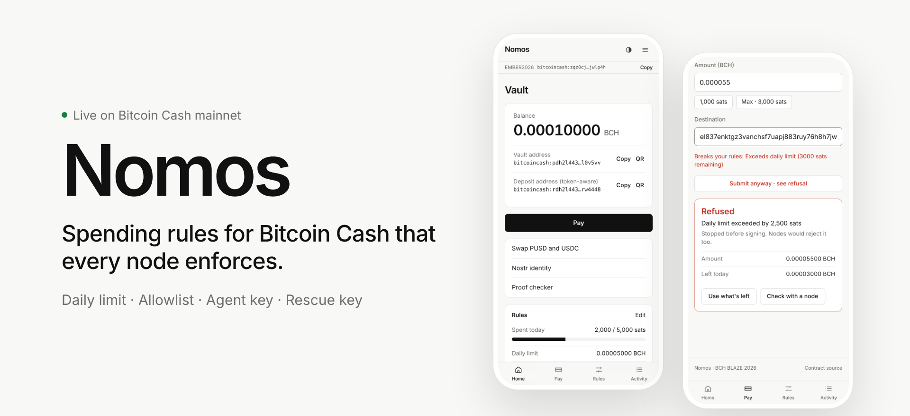
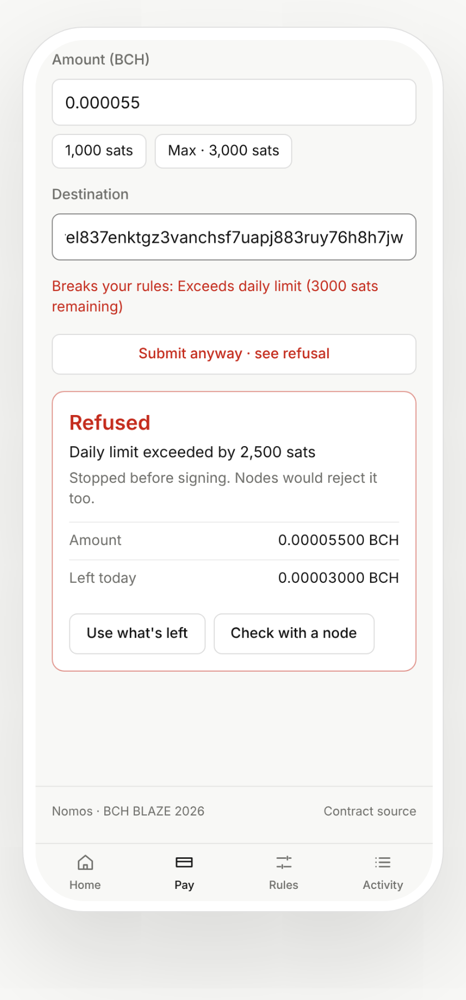

<p align="center">
  <a href="https://nomos.asgaya.org">
    <picture>
      <source media="(prefers-color-scheme: dark)" srcset=".github/assets/banner-dark.png" />
      <source media="(prefers-color-scheme: light)" srcset=".github/assets/banner-light.png" />
      
    </picture>
  </a>
</p>

<h1 align="center">Nomos</h1>
<p align="center"><b>Spending rules for Bitcoin Cash that every node enforces.</b><br/>A daily limit, an allowlist, an agent key and a rescue key, written into the contract that holds your BCH.</p>

<p align="center">
  <a href="https://nomos.asgaya.org"><b>Open the app</b></a>
  &nbsp;·&nbsp;
  <a href="#proof-on-mainnet"><b>Proof on mainnet</b></a>
  &nbsp;·&nbsp;
  <a href="#how-nomos-meets-the-hackathon"><b>How it meets the hackathon</b></a>
  &nbsp;·&nbsp;
  <a href="#cashtokens-address"><b>CashTokens address</b></a>
</p>

Nomos is a vault for Bitcoin Cash with spending rules. Your BCH sits in a **CashScript** contract, and the rules you choose (a **daily limit**, up to five **allowed addresses**, an **agent key** and a **rescue key**) are part of that contract. Every node on the network checks them, so a payment that breaks a rule is not a valid transaction, whoever signs it. The app checks the same rules before your wallet signs, and **Paytaca** signs every transaction over **WizardConnect**. There is no Nomos server and no Nomos fee.

Built for **BCH BLAZE 2026**: the Mainnet Track, with entries for the SolidCash, Decentralized Identity, Stablecoin Bridge and XO bounties. Jump to [how Nomos meets the hackathon](#how-nomos-meets-the-hackathon).

_Nomos_ (νόμος) is Greek for law.

## The problem

A Bitcoin Cash wallet has one key, and that key can spend everything. Wallet apps can show warnings or budgets, but those only exist inside the app: once a payment is signed, the network accepts it. So today:

1. a daily budget is a habit, not a rule anyone enforces;
2. giving spending power to a second person or an AI agent means giving them the key, and with it the whole balance;
3. a stolen phone or a leaked recovery phrase can empty the wallet in one transaction.

## The idea

Put the rules in the coins. Nomos moves your BCH into a contract whose address includes your rules, and keeps what you spent today in a **CashTokens** NFT that travels with the vault. A payment has to spend the vault, stay within what is left today, go to an allowed address (if you set any), and put the vault back with the NFT updated. A payment that doesn't fails the contract, and no node relays it.

**An example.** A vault has a daily limit of 5,000 sats and 2,000 spent today. A payment of 5,500 sats is over the limit by 2,500, so the app refuses it before your wallet is asked to sign. Signed anyway and sent to a Bitcoin Cash node, it is rejected with:

```
mandatory-script-verify-flag-failed (Script failed an OP_VERIFY operation)
```

<p align="center">
  <picture>
    <source media="(prefers-color-scheme: dark)" srcset=".github/assets/captures/refused-dark.png" />
    
  </picture>
</p>

## How it works

1. **Create.** On **Rules**, pick a daily limit and, if you want, up to five allowed addresses (or Nostr names), an agent key and a rescue key. One transaction from your wallet funds the vault and mints its state NFT. The rules are constructor parameters of the contract, so they are part of the vault's address.
2. **Pay.** The app reads the vault and its NFT from a Bitcoin Cash node and checks the payment as you type. Paytaca signs it over WizardConnect. Nomos never sees a key.
3. **Every node checks.** The contract accepts a payment only if the amount fits what is left today, the destination is allowed, and the vault comes back unchanged with its NFT updated to the new total. A new day, read from the transaction's locktime, starts again from zero.
4. **Change the rules.** The owner's signature moves the vault to a new address with the new rules.
5. **Rescue.** The owner and the rescue key together can move everything, for a lost phone or an agent key you no longer trust.

<p align="center">
  <picture>
    <source media="(prefers-color-scheme: dark)" srcset=".github/assets/captures/flow-dark.png" />
    
  </picture>
</p>

The check, from [`contracts/NomosVault.cash`](contracts/NomosVault.cash):

```solidity
// ── Day reset logic ──
int currentDay = tx.locktime / 86400;
int effectiveSpent = 0;
if (currentDay == dayMarker) {
    effectiveSpent = spentTodaySats;
}

// ── Daily limit check ──
require(effectiveSpent + amount <= dailyLimitSats);
...
// Output 0 NFT must carry updated state
int newSpent = effectiveSpent + amount;
bytes newCommitment = bytes8(newSpent) + bytes8(currentDay);
require(tx.outputs[0].nftCommitment == newCommitment);
```

### Built on

| Piece | What it does in Nomos | Where in the code |
| --- | --- | --- |
| [CashScript](https://cashscript.org) 0.11 | The vault: daily limit, allowlist, agent key, rule changes and rescue | [`contracts/NomosVault.cash`](contracts/NomosVault.cash) |
| [CashTokens](https://cashtokens.org) | A mutable NFT holds what was spent today and which day it was | [`contracts/NomosVault.cash`](contracts/NomosVault.cash), [`frontend/src/lib/contract.ts`](frontend/src/lib/contract.ts) |
| [WizardConnect](https://docs.riftenlabs.com/wizardconnect) | Connects Paytaca and signs every transaction from your wallet | [`frontend/src/lib/wallet.ts`](frontend/src/lib/wallet.ts), [`frontend/src/context/WalletContext.tsx`](frontend/src/context/WalletContext.tsx) |
| WalletConnect v2 | Other Bitcoin Cash wallets; any EVM wallet for the Base side of the swap | [`frontend/src/lib/wallet.ts`](frontend/src/lib/wallet.ts), [`frontend/src/lib/evm.ts`](frontend/src/lib/evm.ts) |
| Electrum (Fulcrum servers) | Reads the vault and its NFT, broadcasts transactions | [`frontend/src/lib/contract.ts`](frontend/src/lib/contract.ts) |
| [SolidCash](https://solidcash.org) 0.51 | The same vault in Solidity syntax, run on mainnet | [`contracts/solidcash/`](contracts/solidcash) |
| [XO](https://xo.cash) | The vault as an XO template: pay, top up, withdraw, two-party rescue | [`xo/`](xo) |
| Nostr (NIP-05, NIP-07, NIP-39) | Pay by Nostr name; link a BCH address to a Nostr key | [`frontend/src/lib/nostr.ts`](frontend/src/lib/nostr.ts), [`frontend/src/lib/identity.ts`](frontend/src/lib/identity.ts) |
| Base | The USDC side of the PUSD and USDC swap | [`contracts/evm/SwapLock.sol`](contracts/evm/SwapLock.sol), [`frontend/src/lib/swap.ts`](frontend/src/lib/swap.ts) |

## How Nomos meets the hackathon

| Track or bounty | What Nomos does | Check it |
| --- | --- | --- |
| **Mainnet Track**: integrate WizardConnect or an XO template | Both. Paytaca signs every transaction over WizardConnect, and the vault is also an XO template | [`frontend/src/lib/wallet.ts`](frontend/src/lib/wallet.ts), [`xo/nomos.template.json`](xo/nomos.template.json) |
| **Mainnet Track**: transactions on BCH mainnet | The SolidCash vault deployed, paid and rescued on mainnet; an over-limit payment rejected by a mainnet node | [Proof on mainnet](#proof-on-mainnet) |
| **Mainnet Track**: a banner with the Widget Factory deck, the repository and a CashTokens address | On every app page and at the foot of the landing page | [`frontend/src/components/Banner.tsx`](frontend/src/components/Banner.tsx), [`frontend/src/pages/Landing.tsx`](frontend/src/pages/Landing.tsx) |
| **Mainnet Track**: a live demo | [nomos.asgaya.org](https://nomos.asgaya.org), no account needed; the [simulator](https://nomos.asgaya.org/simulate) needs no wallet | [`docs/JUDGE_PATH.md`](docs/JUDGE_PATH.md) |
| **Best SolidCash Application** | The vault written in SolidCash, where the compiler builds the NFT covenant from a plain state variable; deployed, paid, refused and rescued on mainnet; 14 checks in the BCH VM | [`contracts/solidcash/`](contracts/solidcash) |
| **Decentralized Identity** | A BCH address and a Nostr key linked by both keys (an on-chain anchor and a NIP-39 claim), verify links anyone can open, challenge-response login other apps can check, and payments and allowlists by Nostr name | [`docs/IDENTITY_PROTOCOL.md`](docs/IDENTITY_PROTOCOL.md), [`/identity`](https://nomos.asgaya.org/identity) |
| **Stablecoin Bridge** | A peer-to-peer atomic swap of PUSD on Bitcoin Cash for USDC on Base, both directions, with hash-time locks on each chain and no custodian | [`contracts/SwapLock.cash`](contracts/SwapLock.cash), [`contracts/evm/SwapLock.sol`](contracts/evm/SwapLock.sol), [`/bridge`](https://nomos.asgaya.org/bridge) |
| **Build with XO / Migrate to XO** | The vault as an XO template with four actions; 14 offline checks with XO's own parser and compiler; the vault created on chipnet through XO's engine | [`xo/README.md`](xo/README.md), [`xo/REPRODUCE.md`](xo/REPRODUCE.md) |
| **Community Choice** | The EMBER2026 address on the landing page, in the app banner and [below](#cashtokens-address) | |

## CashTokens address

<p align="center">
  
</p>
<p align="center"><code>bitcoincash:zqz0cjlclvk6909mctktqsk77d7z6gev0cqejwlp4h</code></p>

Nomos's token-aware Bitcoin Cash address, the one the banner shows. EMBER2026 holders vote for Nomos in Community Choice by sending their tokens here. Scan it with Paytaca.

## Proof on mainnet

**SolidCash vault, 20 November 2026**, daily limit 2,000 sats, run with [`contracts/solidcash/demo.mjs`](contracts/solidcash/demo.mjs):

| Step | Result |
| --- | --- |
| Deploy, 5,000 sats deposited | [`bee48c5f…`](https://blockchair.com/bitcoin-cash/transaction/bee48c5f73f16a9ad83669b4a1350d01e07ebf104d155e2b557837e9fd04113d) |
| Pay 1,000 sats | **Paid** [`93e9fdad…`](https://blockchair.com/bitcoin-cash/transaction/93e9fdadaf3ebc5b5182a5b3dcd527b8ab9c6d8480160276a573b9d7b616aae6) |
| Pay 1,500 more the same day | **Refused** at [`NomosVault.scash:43`](contracts/solidcash/NomosVault.scash#L43), not broadcast |
| Rescue the remaining 4,000 sats (owner and co-signer) | [`305c7a47…`](https://blockchair.com/bitcoin-cash/transaction/305c7a47a2721ba1b290782df991b5a99bc1da7553b734d764f53e5f81ff913f) |

Every transaction, by component, is in [`docs/MAINNET_PROOFS.md`](docs/MAINNET_PROOFS.md).

Also checked:

- **The SolidCash vault in the BCH VM**: 14 checks on a mock network cover payments, refusals failing at their exact `require`, the allowlist, the day reset, deposits and rescue.
- **The XO template**: 14 offline checks with XO's own parser and compiler show every script matches CashScript byte for byte inside transactions the covenant accepts, and that an over-limit payment is refused. A live run through XO's engine created the vault on chipnet ([`d73393f2…`](https://chipnet.chaingraph.cash/tx/d73393f2355f97bf98f2c8827f5e6ddf2b8d76756e27369d1b5f460c70db2b66)).
- **The swap locks**: `SwapLock.cash` in the BCH VM (right secret and key pass; a wrong secret, the wrong key and early refunds fail), and `SwapLock.sol` on a local Foundry node against a mock USDC.
- **Chipnet**: `contracts/test/vault.test.mjs` paid 3,000 sats ([`2dac2f0f…`](https://chipnet.chaingraph.cash/tx/2dac2f0f7aa9020bc884bd6a1a871e135ef9ff2989729da233972971b3d77ed2)), then a node refused 7,001 more with the same `OP_VERIFY` failure.

### The rest of Nomos

- **Pay by Nostr name**: type an `npub`, `nprofile` or `name@domain` instead of an address. The address is checked against the key's signed event in your browser, and the daily limit and allowlist still apply.
- **BCH and Nostr identity**: link your address to your Nostr key with both keys signing, share `nomos.asgaya.org/identity?verify=…`, and prove control with a signed challenge ([protocol](docs/IDENTITY_PROTOCOL.md)).
- **Proof checker** (`/proof`): sends a signed payment that breaks your rules to a node and saves its answer, or checks signed transaction hex without a wallet.
- **Simulator** (`/simulate`): the daily limit and allowlist with example numbers, no wallet needed.
- **Swap PUSD and USDC** (`/bridge`): offers between two people through an offer link; each side's lock refunds after its timeout.
- **Activity**: every payment, refusal and rule change, each with a receipt you can save as an image, copy or share.
- Light and dark themes, tabs on phones and keyboard shortcuts on desktop (press `?`).

## Run it locally

Needs Node.js 22 or newer.

```bash
cd frontend
cp .env.example .env      # VITE_BCH_NETWORK=chipnet for testing
npm ci
npm run dev               # the app
npm run build             # type check and production build

cd ../contracts/solidcash && npm ci && npm test   # SolidCash vault, StableSwap and HTLC in the BCH VM
cd ../../xo && npm ci && npm test                 # XO template checks against CashScript
```

```
contracts/
  NomosVault.cash          the vault (CashScript)
  solidcash/               the vault in SolidCash, its mainnet demo and mock-network tests
  SwapLock.cash            the PUSD side of the swap
  evm/SwapLock.sol         the USDC side of the swap (Base)
  test/                    chipnet tests: mint, paid and refused
frontend/src/
  pages/                   Landing, Connect, Vault, Rules, Pay, Activity, Proof, Rescue,
                           Swap, Identity, Simulate, How it's built
  components/              layout, banner, tabs, receipts, identity link
  lib/                     wallet, contract, Nostr, identity, swap, Base, links
xo/                        the XO template and its checks
docs/                      judge path, mainnet proofs, identity protocol, architecture, security
.github/assets/            banner, captures, QR code, demo cover
```

## Limits

- **Rescue needs two signatures** (owner and co-signer). A wallet connection signs with one key, so in the app rescue works when both are the same key; with separate keys, use the XO template's rescue action.
- **Top-ups and agents.** BCH sent straight to the vault address, outside the NFT coin, can only be merged by the owner. An agent pays from the main vault coin; the owner merges top-ups by paying once or updating the rules.
- **Swaps need a counterparty.** Nomos runs no pool or market maker; the Base contract is deployed once from the Swap page.
- **Nostr lookups** depend on public relays, which can be slow or return old results.

## Documentation

- [`docs/JUDGE_PATH.md`](docs/JUDGE_PATH.md): the quickest way through the app and the tests.
- [`docs/MAINNET_PROOFS.md`](docs/MAINNET_PROOFS.md): every mainnet transaction, by component.
- [`docs/IDENTITY_PROTOCOL.md`](docs/IDENTITY_PROTOCOL.md): the BCH and Nostr link: formats, verification, challenge-response, removal.
- [`docs/ARCHITECTURE.md`](docs/ARCHITECTURE.md): routes, modules and contracts.
- [`docs/SECURITY.md`](docs/SECURITY.md): trust boundaries and known risks.
- [`docs/BRIDGE_DESIGN.md`](docs/BRIDGE_DESIGN.md): the PUSD and USDC swap, and the earlier StableSwap and HTLC prototypes.
- [`contracts/solidcash/README.md`](contracts/solidcash/README.md): the SolidCash contracts, tests and mainnet run.
- [`xo/README.md`](xo/README.md) and [`xo/REPRODUCE.md`](xo/REPRODUCE.md): the XO template, its checks and the live chipnet run.
- [`CONTRIBUTING.md`](CONTRIBUTING.md): setup and package commands.

## Licence

[MIT](LICENSE). Get BCH peer to peer on [Mercar](https://mercar.asgaya.org/).
